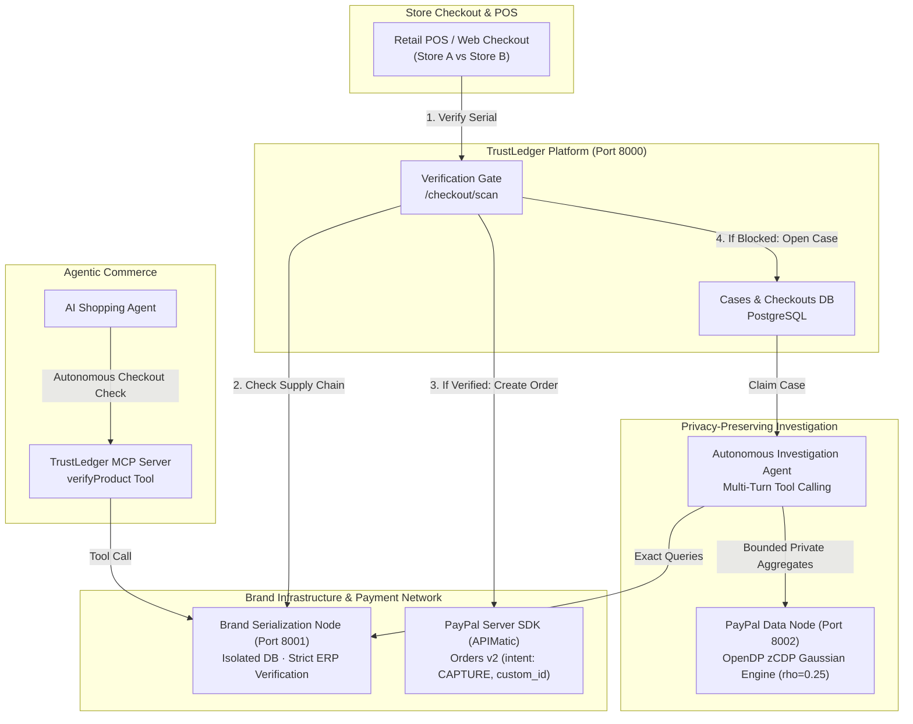

# TrustLedger

[](https://github.com/ParthSinha9498/trustledger/actions/workflows/ci.yml)
[-003087?logo=paypal&logoColor=white)](docs/APIMATIC.md)
[](evals/results/redteam_repeated.md)
[](LICENSE)

**Make product authenticity a condition of payment.**

TrustLedger bridges physical brand serialization and digital checkout. Before any PayPal order is created, the brand verifies the serialized unit against its verified supply chain. If genuine, PayPal creates the payment with the verification ID stored in the order's `custom_id`. If counterfeit or diverted, payment is blocked before money moves, and an autonomous AI agent investigates the failure using differential privacy aggregates.

---

## 60-Second Tour

### 1. Store Checkout: Brand Verification Gating Payment
When an authorized retailer scans a genuine unit, the brand confirms provenance. The platform calls the **PayPal Server SDK (generated via APIMatic)** to create an Order with the verification ID stored in `custom_id`.


---

### 2. Off-Channel Divergence: Zero Payment Created
When a store attempts to sell an out-of-channel or cloned serial (e.g. Serial `X123` at Store B), the brand flags `NOT_IN_CHANNEL`. **No PayPal order is ever created.** The transaction is deterministically blocked, and an automated investigation case is opened.


---

### 3. Side-by-Side Verification Contrast
Authenticity is enforced at the commerce layer. Genuine units proceed smoothly to PayPal checkout; diverted or fake units are halted before authorization.


---

### 4. Autonomous Brand Cockpit & Agent Investigation
The brand's AI investigator automatically claims the case. Operating under strict differential privacy bounds, the agent queries brand distribution logs and federated PayPal data, discovering where the evidence diverges while citing individual audit steps.


---

### 5. Privacy Console: Zero-Concentrated Differential Privacy
Security and privacy teams can plan and execute structured queries across siloed brand and payment nodes. Queries to PayPal buyer data pass through an **OpenDP Gaussian mechanism** with persistent privacy budgeting ($\rho = 0.25$ zCDP), dynamic confidence intervals (±CI), and automated cell suppression.


---

### 6. Interactive Supply Chain Timeline
Built with **Bryntum Scheduler**, the supply chain explorer traces batches from brand factories through regional distributors to retail endpoints, instantly highlighting off-channel anomalies in red.


---

### 7. Executive Narrative & Pitch Deck
An integrated interactive story deck at `/story` articulates the macro counterfeit problem ($467B global counterfeit trade), the architectural solution, and live interactive cards.


---

## Architecture



---

## What's Real vs. Simulated

| Component | Status | Details |
|---|---|---|
| **PayPal Orders v2** | **Real (Sandbox)** | Orders v2 (`intent: CAPTURE`, order retrieval, and capture) implemented with the APIMatic-generated PayPal Server SDK (`paypal-server-sdk`), leveraging APIMatic's PayPal Context Plugin (see [docs/APIMATIC.md](docs/APIMATIC.md)). Webhook signature verification and browser client token exchange call PayPal REST directly via httpx (as the server SDK does not provide endpoints for them). |
| **Differential Privacy** | **Real (OpenDP)** | Zero-concentrated differential privacy (zCDP) Gaussian mechanism using OpenDP, per-buyer contribution bounding ($k=4$ cells, clamp 1000), persistent database budget ledger ($\rho=0.25$), response caching, and 95% confidence intervals. |
| **Investigation Agent** | **Real (Live LLM)** | Multi-turn autonomous agent loop with structured tool calling (`query_brand_node`, `query_paypal_node`, `record_finding`), dynamic step budgeting, and evidence citations. |
| **MCP Server** | **Real (Protocol)** | Model Context Protocol server generated with `openapi-mcp-generator` exposing `verifyProduct` and `confirmSale` tools for autonomous AI shopping agents. |
| **UI Experience** | **Real** | Next.js 16 (Turbopack) & React 19 web suite featuring AG Grid Community tables, AG Charts Community visualizations, and Bryntum Scheduler supply chain timelines. |
| **Brand Serialization** | **Simulated Node** | In production, brands maintain private ERP/serialization databases. Here, an isolated microservice (`backend/brand_node/`, port 8001) simulates the brand's private verification API. |
| **Buyer Demographics** | **Simulated Data** | PayPal APIs do not expose customer demographic attributes. Synthetic demographic attributes demonstrate federated differential privacy across commerce nodes. |
| **Catalog & Seed Data** | **Simulated Dataset** | All product SKUs, serial numbers, distributor shipments, retail transactions (7,600 rows), and planted supply chain leaks are generated fictional data. |

---

## Evidence & Evaluation

### Differential Privacy Red-Teaming
TrustLedger underwent rigorous differential privacy red-teaming evaluating resistance against privacy extraction attacks:
- **Result:** **220 of 220 reconstruction attacks blocked** across 20 repeated runs of 11 distinct attack archetypes (differencing, small cells, membership inference, cross-node linkage, averaging, budget exhaustion). Attacker success was **0 of 220** (no attack exceeded the confidence threshold needed for linkage).
- **Best guesses:** when the attacks fell back to unconfident guesses about a buyer's age band or gender, they were right **23%** of the time (25 of 107), in line with chance (20% for age band, 33% for gender). Details: [evals/results/redteam_repeated.md](evals/results/redteam_repeated.md).
- **Report:** Full methodology, audit logs, and parameters documented in [evals/results/redteam_repeated.md](evals/results/redteam_repeated.md).

### Live Detection Evaluation
- Placeholder for live detection evaluation benchmarks against real counterfeit diversion patterns (to be populated from live evaluation runs).

---

## Sponsor Technology Highlights

1. **PayPal Server SDK (APIMatic)**:
   - Built with the official APIMatic PayPal Context Plugin.
   - Powers backend order creation with `intent: CAPTURE`, strict currency handling, and storing the brand verification ID in the order's `custom_id`.
   - Comprehensive implementation details in [docs/APIMATIC.md](docs/APIMATIC.md).
2. **AG Grid Community**:
   - Powers the high-performance investigations table in the Brand Cockpit (`/cockpit`), featuring responsive column pinning, status badges, and sub-second filtering.
3. **Bryntum Scheduler**:
   - Delivers the interactive multi-tier supply chain visualization (`/cockpit/supply-chain`), displaying brand dispatches, distributor inventory, and store receipts across time.
4. **OpenDP**:
   - Core mathematical foundation for the differential privacy Gaussian mechanism guaranteeing bounded privacy leakage on federated demographic analytics.
5. **Render**:
   - All-in-one free-plan container / Render web service connecting the web frontend, platform gateway, brand node, and PayPal node. See [docs/DEPLOY.md](docs/DEPLOY.md).

---

## Quickstart & Local Setup

### 1. Prerequisites
- Python 3.12+ with `uv`
- Node.js 22+ with `npm`
- Docker (for PostgreSQL 17 on port 5433)

### 2. Start Services
```bash
# 1. Environment & Database
cp .env.example .env
docker compose up -d postgres
uv sync

# 2. Seed Data
uv run python -m backend.seed

# 3. Start Backend Nodes
uv run --env-file .env uvicorn backend.brand_node.main:app --port 8001 &
uv run --env-file .env uvicorn backend.paypal_node.main:app --port 8002 &
uv run --env-file .env uvicorn backend.api.main:app --port 8000 &

# 4. Start Web Application
cd web && npm install && npm run dev
```

Visit **http://localhost:3000** to explore the application:
- `/pos`: Test retail verification (Store A = Verified, Store B = Blocked)
- `/cockpit`: View live investigations and agent findings
- `/cockpit/console` (alias `/cockpit/insights`): Brand Insights, business questions answered from verified purchases with privacy guarantees
- `/cockpit/supply-chain`: Explore the Bryntum timeline
- `/story`: Walk through the pitch deck

Full cloud deployment and production configuration details are available in [docs/DEPLOY.md](docs/DEPLOY.md).

---

## License

MIT
