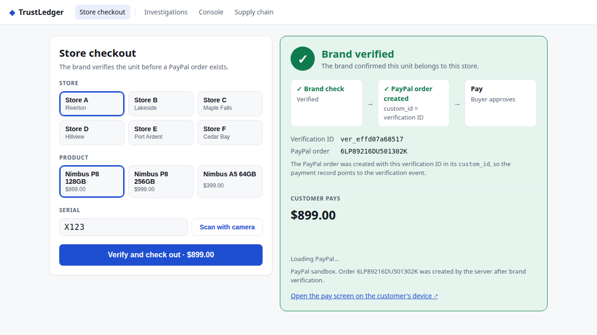
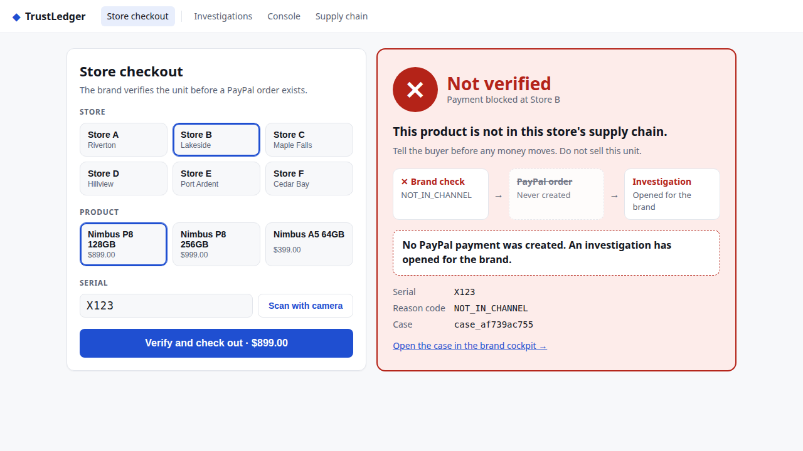
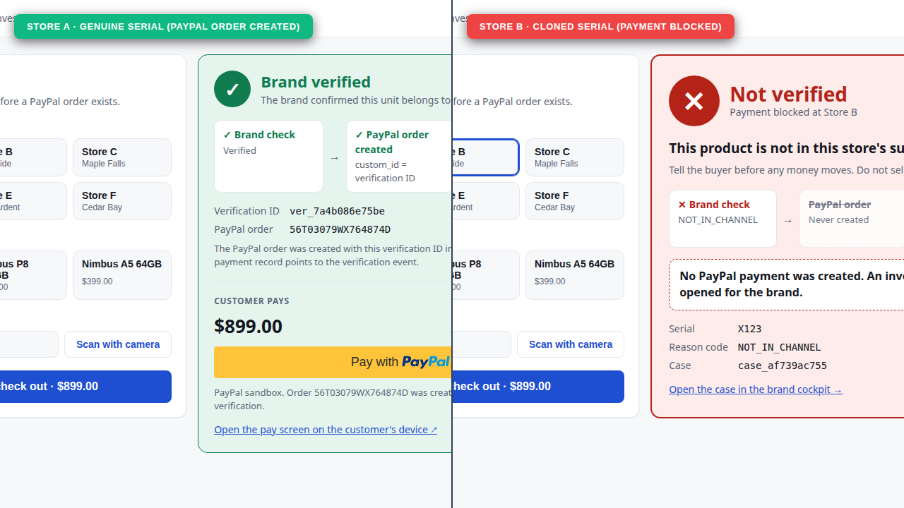
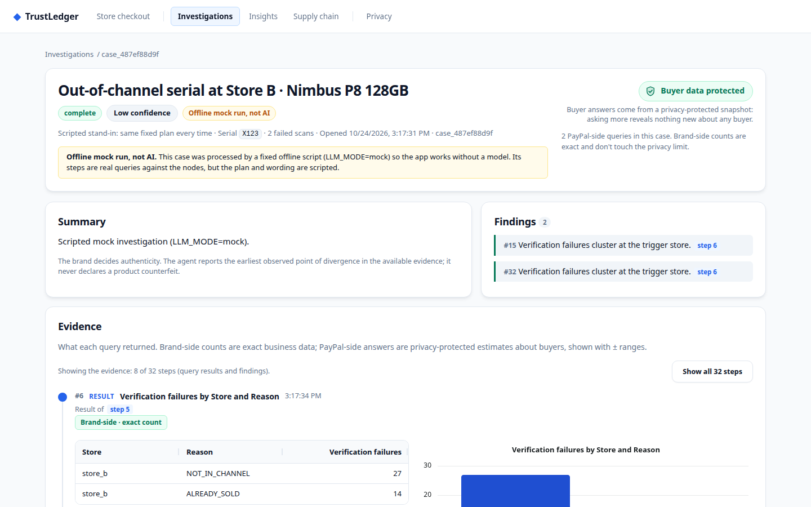
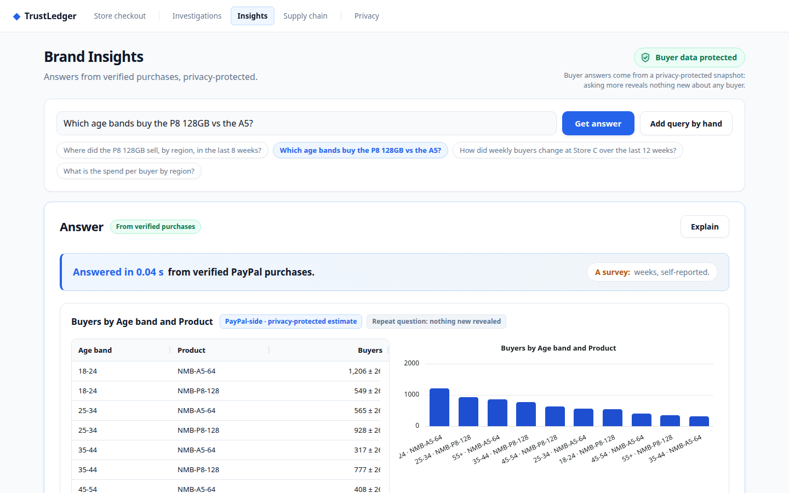
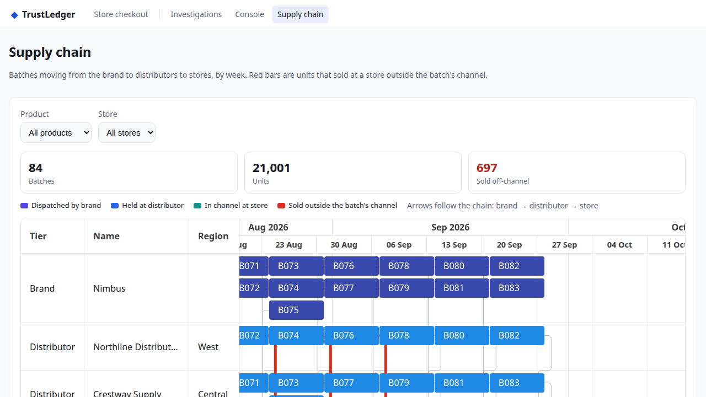
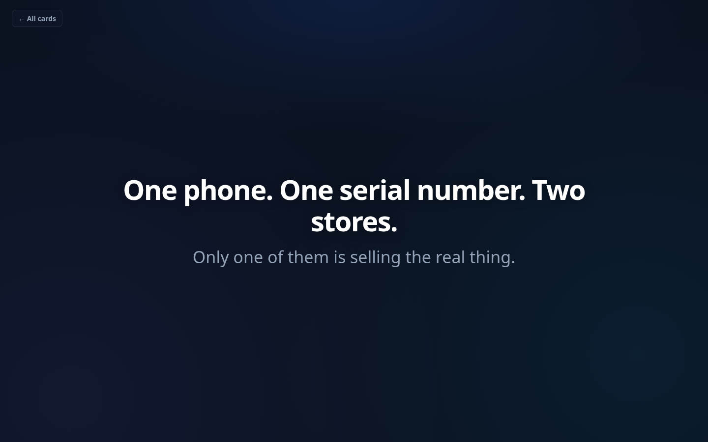
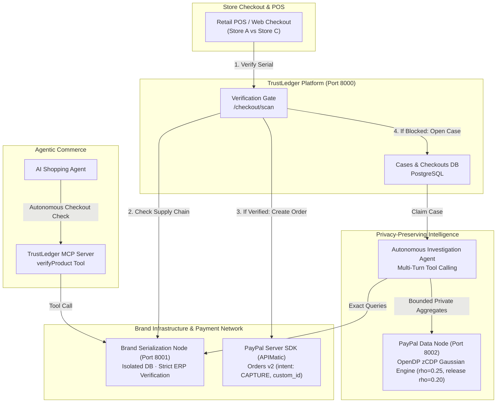

# TrustLedger

[](https://github.com/ParthSinha9498/trustledger/actions/workflows/ci.yml)
[-003087?logo=paypal&logoColor=white)](docs/APIMATIC.md)
[](evals/results/redteam_repeated.md)
[](LICENSE)

**Make product authenticity a condition of payment.**

TrustLedger bridges physical brand serialization and digital checkout. Before any PayPal order is created, the brand verifies the serialized unit against its verified supply chain. If genuine, PayPal creates the payment with the verification ID stored in the order's `custom_id`. If counterfeit or diverted, payment is blocked before money moves, and an autonomous AI agent investigates the failure using differential privacy aggregates.

---

## 60-Second Tour

### 1. Store Checkout: Brand Verification Gating Payment
When an authorized retailer scans a genuine unit, the brand confirms provenance. The platform calls the **PayPal Server SDK (generated via APIMatic)** to create an Order with the verification ID stored in `custom_id`. <!-- preflight-allow -->



---

### 2. Off-Channel Divergence: Zero Payment Created
When a store attempts to sell an out-of-channel or cloned serial (e.g. Serial `X123` at Store C), the brand flags `NOT_IN_CHANNEL`. **No PayPal order is ever created.** The transaction is deterministically blocked, and an automated investigation case is opened.



---

### 3. Side-by-Side Verification Contrast
Authenticity is enforced at the commerce layer. Genuine units proceed smoothly to PayPal checkout; diverted or fake units are halted before authorization.



---

### 4. Autonomous Brand Cockpit & Agent Investigation
The brand's AI investigator automatically claims the case. Operating under strict differential privacy bounds, the agent queries brand distribution logs and federated PayPal data, discovering where the evidence diverges while citing individual audit steps.



---

### 5. Privacy Console: Zero-Concentrated Differential Privacy
Security and privacy teams can plan and execute structured queries across siloed brand and payment nodes. Queries to PayPal buyer data pass through an **OpenDP Gaussian mechanism** with persistent privacy budgeting ($\rho = 0.25$ zCDP $\approx \varepsilon = 4.16$, $\delta = 10^{-8}$) and a one-time private release ($\rho = 0.20 \approx \varepsilon = 3.69$, $\delta = 10^{-8}$), dynamic confidence intervals (±CI), and automated cell suppression.



---

### 6. Interactive Supply Chain Timeline
Built with **Bryntum Scheduler**, the supply chain explorer traces batches from brand factories through regional distributors to retail endpoints, instantly highlighting off-channel anomalies in red.



---

### 7. Executive Narrative & Pitch Deck
An integrated interactive story deck at `/story` articulates the macro counterfeit problem ($467B global counterfeit trade), the architectural solution, and live interactive cards.



---

## Architecture



---

## What's Real vs. Simulated

| Component | Status | Details |
|---|---|---|
| **PayPal Orders v2** | **Real (Sandbox)** | Orders v2 (`intent: CAPTURE`, order retrieval, and capture) implemented with the APIMatic-generated PayPal Server SDK (`paypal-server-sdk`), leveraging APIMatic's PayPal Context Plugin (see [docs/APIMATIC.md](docs/APIMATIC.md)). Webhook signature verification and browser client token exchange call PayPal REST directly via httpx (as the server SDK does not provide endpoints for them). |
| **Differential Privacy** | **Real (OpenDP)** | Zero-concentrated differential privacy (zCDP) Gaussian mechanism using OpenDP, per-buyer contribution bounding ($k=4$ cells, clamp 1000), persistent database budget ledger ($\rho=0.25$), response caching, and 95% confidence intervals. |
| **Investigation Agent** | **Real (Live LLM)** | Multi-turn autonomous agent loop with structured tool calling (`query_brand_node`, `query_paypal_node`, `record_finding`), dynamic step budgeting, and evidence citations. |
| **MCP Server** | **Real (Protocol)** | Model Context Protocol server generated with `openapi-mcp-generator` exposing `verifyProduct` and `confirmSale` tools for autonomous AI shopping agents. |
| **UI Experience** | **Real** | Next.js 16 (Turbopack) & React 19 web suite featuring AG Grid Community tables, AG Charts Community visualizations, and Bryntum Scheduler supply chain timelines. |
| **Brand Serialization** | **Simulated Node** | In production, brands maintain private ERP/serialization databases. Here, an isolated microservice (`backend/brand_node/`, port 8001) simulates the brand's private verification API. |
| **Buyer Demographics** | **Simulated Data** | PayPal APIs do not expose customer demographic attributes. Synthetic demographic attributes demonstrate federated differential privacy across commerce nodes. |
| **Catalog & Seed Data** | **Simulated Dataset** | All product SKUs, serial numbers, distributor shipments, retail transactions (7,600 rows), and planted supply chain leaks are generated fictional data. |

---

## Evidence & Evaluation

### Differential Privacy Red-Teaming
TrustLedger underwent rigorous differential privacy red-teaming evaluating resistance against privacy extraction attacks:
- **Result:** Across 11 distinct attack types (differencing, small cells, membership inference, cross-node linkage, averaging, budget exhaustion), none extracted a confident individual-level fact (no attack exceeded the confidence threshold needed for linkage).
- **Best guesses:** when the attacks fell back to unconfident guesses about a buyer's age band or gender, they were right **23%** of the time (25 of 107), in line with chance (20% for age band, 33% for gender). Details: [evals/results/redteam_repeated.md](evals/results/redteam_repeated.md).
- **Report:** Full methodology, audit logs, and parameters documented in [evals/results/redteam_repeated.md](evals/results/redteam_repeated.md).

---

## Sponsor Technology Highlights

1. **PayPal Server SDK (APIMatic)**:
   - Built with the official APIMatic PayPal Context Plugin.
   - Powers backend order creation with `intent: CAPTURE`, strict currency handling, and storing the brand verification ID in the order's `custom_id`.
   - Comprehensive implementation details in [docs/APIMATIC.md](docs/APIMATIC.md).
2. **AG Grid + AG Charts (Community)**:
   - Power the investigations table and charts in the Brand Cockpit (`/cockpit`), the Insights answers grid and the supply-chain tables. Details: [docs/sponsors/ag-grid.md](docs/sponsors/ag-grid.md).
3. **Bryntum Scheduler**:
   - The supply-chain timeline (`/cockpit/supply-chain`): batches shipped by each distributor to its stores over time, and where their units were sold. Details: [docs/sponsors/bryntum.md](docs/sponsors/bryntum.md).
4. **OpenDP**:
   - Core mathematical foundation for the differential privacy Gaussian mechanism and private releases on federated demographic analytics.
5. **Render**:
   - Deployment target (Render Blueprint, `render.yaml`): a web service plus one backend service running the API, brand node, PayPal node and worker. See [docs/DEPLOY.md](docs/DEPLOY.md).

---

## Try It & Testing Instructions

> **Hosted demo:** URL added after deployment.

### PayPal sandbox buyer (for the PayPal approval step)

| | |
|---|---|
| Email | `sb-ad2fb53492308@personal.example.com` |
| Password | `*t7)t&9Y` |

Sandbox only (PayPal's test environment, fake money). Needed only when the stack runs with `PAYPAL_MODE=sandbox`; in mock mode
(the default for a local run) no PayPal account or API key is needed and the payment step is simulated.

### Prerequisites
- Python 3.12+ with `uv`
- Node.js 22+ with `npm`
- Docker (for PostgreSQL 17 on port 5433)

### 1. Step-by-Step Testing Walkthrough

Follow these 4 steps to evaluate the end-to-end checkout protection and autonomous intelligence flow:

#### Step 1: Authentic Checkout at Store A
1. Open `/pos` (Store Checkout).
2. Ensure **Store A** is selected. Click **Fill an unsold unit from this store** (or use `X123` on a freshly seeded local stack).
3. Click **Verify and check out**.
4. The brand verifies unit provenance against Store A's authorized distributor shipments.
5. Verification succeeds before any payment order exists.
6. The PayPal checkout flow initiates. Log in with the **PayPal sandbox buyer** below and approve. It is a sandbox account with test money only; no real payment is made.
7. The customer receipt confirms the verified transaction, with the brand verification ID stored in the PayPal order's `custom_id`.

#### Step 2: Out-of-channel block at Store C
1. Return to `/pos`.
2. Switch store selection to **Store C**.
3. Enter serial `X123` (Store A stock) or an unsold Store A unit (e.g. `XA000001`).
4. Click **Verify and check out**.
5. The transaction is deterministically blocked: `NOT_IN_CHANNEL`.
6. No PayPal order exists, so nothing can be paid. An automated investigation case is opened for the brand.

#### Step 3: Autonomous Investigation in the Cockpit
1. Open `/cockpit` (Investigations).
2. The Store C case appears (new, or added to an open case for the same store).
3. Open the case to observe the autonomous investigation agent at work.
4. The agent sees only aggregates: business-level counts from the brand node and privacy-protected aggregates from PayPal. It never sees a record.
5. If the AI provider is unavailable, the case shows waiting capacity with the reason and is retried later.

#### Step 4: Differential Privacy Brand Insights
1. Open `/cockpit/console` (alias `/cockpit/insights`).
2. Explore audience questions answered from the private release (customer age bands, product distributions, spend estimates).
3. Answers about buyers (age bands, spend) come from the one-time private release, with a 95% interval (±) on every value and small groups hidden; asking them spends no further privacy budget. Brand-side counts (units sold) are exact, because they describe businesses, not people.

---

### 2. Demo Serials Reference

All test serials originate deterministically from `backend/seed.py`:

| Serial / Pattern | SKU | Origin in `backend/seed.py` | Behavior & Expected Verdict |
|---|---|---|---|
| `X123` | `NMB-P8-128` | `DEMO_SERIAL = "X123"` (line 49, lines 173-177) | **Genuine at Store A (`VERIFIED`):** In `seed.py:46`, Store A is supplied by Distributor 1. `X123` is part of Distributor 1's shipment to Store A, so provenance confirms and PayPal checkout opens until it is sold (reseed to reset).<br/>**Blocked at Store C (`NOT_IN_CHANNEL`):** Store C is supplied exclusively by Distributor 2 (`seed.py:46`). When `X123` is presented at Store C, the brand node finds the unit's batch was shipped to Store A, not Store C (`backend/brand_node/main.py:59-62`), halting payment with zero PayPal order created. |
| `XA000001` .. `XA000491` | `NMB-P8-128` | `DEMO_PREFIX = {"store_a": "XA"}` (line 51, lines 244-250; count depends on the seed) | Unsold genuine inventory at Store A. Verified at Store A; blocked if scanned at Store C (`NOT_IN_CHANNEL`). |
| `XB000001` .. `XB000528` | `NMB-P8-256` | `DEMO_PREFIX = {"store_b": "XB"}` (line 51, lines 244-250; count depends on the seed) | Unsold genuine inventory at Store B. Verified at Store B. *(Note: scanning XB at Store A with the default P8 128GB gives `SKU_MISMATCH`; to get `NOT_IN_CHANNEL`, select Nimbus P8 256GB first).* |
| Pre-seeded clone attempts | Various | `backend/seed.py:234-240` | 40 historical blocked attempts at Store C (`rng.sample(d1_serials, 40)`), pre-populating the verification audit log with `NOT_IN_CHANNEL` and `ALREADY_SOLD`. |

---

### 3. Quick Local Run (Zero External Keys Required)

You can run the entire platform locally in mock mode without configuring external LLM or PayPal API keys:

```bash
# 1. Environment & Database
cp .env.example .env
sed -i 's/^LLM_MODE=live/LLM_MODE=mock/' .env  # offline: PayPal and LLM mocked
docker compose up -d postgres
until docker compose exec -T postgres pg_isready -U postgres; do sleep 1; done
uv sync

# 2. Seed Database (catalog, shipments, transactions, and private release)
uv run python -m backend.seed

# 3. Start Backend Nodes & Worker
uv run --env-file .env uvicorn backend.brand_node.main:app --port 8001 &
uv run --env-file .env uvicorn backend.paypal_node.main:app --port 8002 &
uv run --env-file .env uvicorn backend.api.main:app --port 8000 &
uv run --env-file .env python -m backend.worker.main &

# 4. Start Web Application
cd web && npm install && npm run dev

# 5. Pre-flight before marking a PR ready, from the repo root (build, wording lint, every page at 1440/390, light/dark)
uv run --with playwright python e2e/preflight.py --start --build --api http://localhost:8000
```

*(Note: The sandbox buyer checkout applies only to hosted deployments or when `PAYPAL_MODE=sandbox`.)*

Visit **http://localhost:3000** to explore the application:
- `/pos`: Test retail verification (Store A = Verified, Store C = Blocked)
- `/cockpit`: View live investigations and agent findings
- `/cockpit/console` (alias `/cockpit/insights`): Brand Insights, business questions answered from verified purchases with privacy guarantees
- `/cockpit/supply-chain`: Explore the Bryntum timeline
- `/story`: Walk through the pitch deck

Full cloud deployment and production configuration details are available in [docs/DEPLOY.md](docs/DEPLOY.md).

---

## License

MIT

